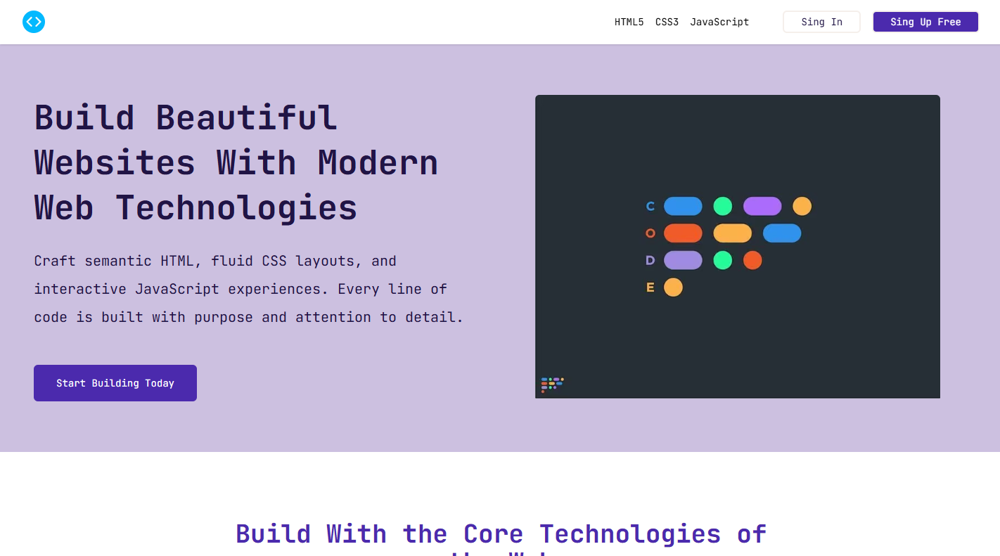

# Podia UI — Frontend Practice

[](https://github.com/14BryanEspinoza/podia/actions/workflows/deploy.yml)
[](https://github.com/14BryanEspinoza/podia/actions/workflows/ci.yml)
[](LICENSE)

> Recreación del challenge **Podia** de [Frontend Practice](https://www.frontendpractice.com/): sitio estático de **una sola página** construido con **Astro 7** (SSG) y **Tailwind CSS v4**, con view transitions, imágenes AVIF/WebP y despliegue automático a GitHub Pages.



---

## 🌐 Demo en vivo

**<https://14bryanespinoza.github.io/podia/>**

---

## 🚀 Inicio rápido

```bash
pnpm install       # instalar dependencias
pnpm dev           # desarrollo local → http://localhost:4321
pnpm preview       # previsualizar el build
```

**Verificación** — los cuatro checks deben pasar en `0`:

```bash
pnpm format:check && pnpm lint && pnpm check && pnpm build
```

| Comando             | Resultado esperado                 |
| ------------------- | ---------------------------------- |
| `pnpm format:check` | 0 archivos sin formatear           |
| `pnpm lint`         | 0 errores                          |
| `pnpm check`        | `astro check`: 0 errores, 0 avisos |
| `pnpm build`        | 2 páginas generadas                |

| Comando adicional | Uso                  |
| ----------------- | -------------------- |
| `pnpm lint:fix`   | `eslint . --fix`     |
| `pnpm format`     | `prettier --write .` |

> **Node ≥ 22.12** (declarado en `package.json` y usado en ambos workflows).

---

## 🎯 Alcance

Esto es una demo de maquetación, no un producto. Lo siguiente es **intencional**, no un pendiente:

| Punto                | Estado real                                                                                                               |
| -------------------- | ------------------------------------------------------------------------------------------------------------------------- |
| **Tipo de proyecto** | Demo de **una sola página** para practicar Astro, Tailwind y accesibilidad. Sin backend.                                  |
| **Enlaces**          | Los 16 enlaces de nav, footer y legales apuntan a `#`: no hay otra página a la que llevar.                                |
| **CTAs**             | Los 4 botones ("Iniciar sesión", "Regístrate gratis", 2× "Empieza a crear hoy") no ejecutan acción.                       |
| **Fuentes**          | No se carga ninguna fuente web: `--font-default` ("JetBrains Mono") cae al monospace del sistema. Cero requests externos. |
| **Tests**            | Fuera de alcance. La garantía de calidad son los cuatro checks de arriba + CI.                                            |
| **Idioma**           | Contenido en español (`lang="es"` en ambas páginas).                                                                      |

---

## ✨ Qué incluye

- **Astro 7 (SSG)** — HTML estático; el JS en cliente son 2 scripts: el `ClientRouter` de view transitions (~16 KB) y un `<script type="module">` inline del menú mobile (~435 B).
- **Tailwind CSS v4** — configuración CSS-first con `@theme` y design tokens en `src/styles/global.css`.
- **Imágenes optimizadas** — `<Picture>` con `formats={["avif", "webp"]}`, `srcset`/`sizes` responsive y Sharp en build.
- **SEO y metadatos** — `title`, `description`, `keywords`, canonical, Open Graph y Twitter Card (con `og:image:alt` y `og:locale`), en `src/metadata/metadata.ts`.
- **astro-icon + Lucide** — iconos SVG con tree-shaking (`@iconify-json/lucide`).
- **Sitemap + robots** — `@astrojs/sitemap` genera `sitemap-index.xml`; `robots.txt` (estático en `public/`) apunta a él.
- **Página 404** propia, con `<title>` diferenciado gracias al prop `title` de `Layout`.
- **TypeScript estricto** — `astro check` sobre `astro/tsconfigs/strict` con `typescript@5.9`, 0 errores.
- **ESLint 10 + Prettier** — plugins de Astro, Tailwind y typescript-eslint, con `--check` en CI.
- **Husky + lint-staged** — `prettier` + `eslint --fix` en cada commit.
- **CI + Deploy separados** — un workflow valida, otro publica.

---

## ♿ Accesibilidad

- **Skip link real** — en `Layout.astro` (`"Saltar al contenido principal"`); el destino `#main-content` existe en `index.astro` y `404.astro`, verificado en el HTML compilado.
- **Menú mobile con teclado** — `<button>` con `aria-expanded`/`aria-controls`/`aria-label` en español; `Escape` cierra y devuelve el foco al botón; se colapsa al seguir un enlace.
- **Semántica HTML5** — `header`, `main`, `section`, `footer`, `nav`, `figure`, `blockquote`; `role="list"` en las listas de enlaces.
- **11 `alt` descriptivos** en el mismo idioma que el contenido: 10 de las imágenes y 1 del logo del header.
- **FAQ accesible** — 5 preguntas con `<details>`/`<summary>` nativos.
- **Jerarquía de encabezados** — 1 `h1` → 7 `h2` → 16 `h3`, sin `id` duplicados (verificado en `dist/index.html`).
- **`:focus-visible` global** con outline de 2px sobre `--color-primary`.
- **`prefers-reduced-motion`** desactiva animaciones, transiciones y `scroll-behavior`.
- **Contraste AA/AAA medido** sobre los tokens reales de `src/styles/global.css`:

| Elemento                                   | Color                     | Ratio         |
| ------------------------------------------ | ------------------------- | ------------- |
| Texto principal                            | `#120926` sobre blanco    | 19.22:1 (AAA) |
| Texto secundario                           | `#5c43a3` sobre blanco    | 7.54:1 (AAA)  |
| Texto secundario sobre `bg-secondary`      | `#5c43a3` sobre `#f7f5fa` | 6.96:1 (AA)   |
| Botón primario (`text-bg` sobre `primary`) | `#ffffff` sobre `#5833e4` | 6.98:1 (AA)   |
| Indicador de foco `:focus-visible`         | `#5833e4` sobre blanco    | 6.98:1 (AA)   |
| Links del footer                           | `#f7f5fa` sobre `#120926` | 17.75:1 (AAA) |

---

## ⚡ Performance

| Optimización               | Implementación                                                              |
| -------------------------- | --------------------------------------------------------------------------- |
| **AVIF + WebP responsive** | 10 `<Picture formats={["avif","webp"]}>` (hero, testimonial y 8 de galería) |
| **`srcset` + `sizes`**     | 29 `srcset` con anchos de 374w a 736w, elegidos por el navegador            |
| **LCP con prioridad**      | Hero con `priority` → `fetchpriority="high"` + `loading="eager"`            |
| **Below-the-fold lazy**    | 9 imágenes con `loading="lazy"` + `decoding="async"`                        |
| **Sin fuentes externas**   | 0 requests de fuente: sin `@font-face`, `preconnect` ni `preload`           |
| **JS mínimo**              | 2 scripts: `ClientRouter` (~16 KB) + inline del menú (~435 B)               |
| **Sitemap + robots**       | `sitemap-index.xml` generado en build; `robots.txt` estático lo referencia  |
| **Sharp en build**         | AVIF `effort: 4`, WebP `effort: 5`, mozjpeg, PNG `compressionLevel: 9`      |

---

## 📁 Estructura

```text
src/
├── assets/              # 10 imágenes (8 JPG + 2 PNG) procesadas por Astro en build
├── components/          # Button, Link, Cards, ContainerText, Cite
├── data/                # products, books, faq, gallery, affiliates, links, cite
├── layouts/             # Layout, Header, Hero, Products, Feature, Testimonial, Gallery, Affiliates, Faq, Footer
├── metadata/            # metadata.ts (title, description, OG, Twitter, canonical)
├── pages/               # index.astro, 404.astro
└── styles/              # global.css (design tokens + reset de accesibilidad)
public/
├── favicon.png          # favicon y logo del header
├── preview.png          # imagen Open Graph / Twitter Card
└── robots.txt           # con referencia al sitemap-index.xml
.github/workflows/
├── ci.yml               # lint + format:check + build + astro check
└── deploy.yml           # build + deploy a GitHub Pages
```

Aliases de `tsconfig.json`: `@assets`, `@components`, `@data`, `@layouts`, `@metadata`.

---

## 🧱 Componentes

| Componente            | Rol y props reales                                                                                                       |
| --------------------- | ------------------------------------------------------------------------------------------------------------------------ |
| `Layout.astro`        | Shell HTML: metadata SEO, Open Graph/Twitter, favicon vía `BASE_URL`, skip link, `<ClientRouter>`; prop opcional `title` |
| `Header.astro`        | Navbar sticky con menú mobile accesible: `<button aria-expanded aria-controls>`, cierra con `Escape` y devuelve el foco  |
| `Hero.astro`          | `h1`, párrafo, CTA y `<Picture priority>` del wallpaper                                                                  |
| `Products.astro`      | `ContainerText` + grilla de `Cards` (tecnologías core)                                                                   |
| `Feature.astro`       | `ContainerText` + `Cards` con variante `book` (herramientas y prácticas)                                                 |
| `Testimonial.astro`   | Imagen lazy, `Cite`, párrafo y CTA                                                                                       |
| `Gallery.astro`       | 8 `<Picture>` lazy en grilla responsive                                                                                  |
| `Affiliates.astro`    | `ContainerText` + 3 `Cards` variante `book` ("Aprende", "Crea", "Únete")                                                 |
| `Faq.astro`           | 5 preguntas con `<details>`/`<summary>` nativos                                                                          |
| `Footer.astro`        | 3 columnas de links + links legales + copyright. Sin redes sociales                                                      |
| `Button.astro`        | Props: `label`, `className?`, `variant?` (boolean). Sin `type` ni evento: no ejecuta acción                              |
| `Link.astro`          | Props: `url`, `label`, `className?`, `skip?` (variante para el skip link)                                                |
| `ContainerText.astro` | Props: `title`, `description` — `h2` + párrafo centrados                                                                 |
| `Cards.astro`         | Props: `title`, `description`, `icon?`, `book?`, `className?` — `<article>` con icono Lucide opcional                    |
| `Cite.astro`          | `<blockquote>` con cita y autor; importa `src/data/cite.ts` directamente (sin props)                                     |

Las secciones (`Products`, `Feature`, `Gallery`, `Affiliates`, `Faq`) se componen desde `src/pages/index.astro` con los datos de `src/data/`.

---

## 📦 Datos y metadata

| Archivo                    | Contenido                                                                                                 |
| -------------------------- | --------------------------------------------------------------------------------------------------------- |
| `src/data/products.ts`     | Tecnologías core (4 cards con iconos Lucide) e interfaz `CardsProps`                                      |
| `src/data/books.ts`        | Herramientas y prácticas del desarrollo moderno (reutiliza `CardsProps`)                                  |
| `src/data/faq.ts`          | 5 preguntas frecuentes                                                                                    |
| `src/data/gallery.ts`      | 8 imágenes con imports de `@assets` y `alt` en español                                                    |
| `src/data/affiliates.ts`   | 3 características: "Aprende a tu propio ritmo", "Crea proyectos reales", "Únete a una comunidad de apoyo" |
| `src/data/links.ts`        | Nav (3), columnas de footer (10) y legales (3) — todos con `url: "#"`                                     |
| `src/data/cite.ts`         | Cita destacada con autor y trabajo                                                                        |
| `src/metadata/metadata.ts` | Título, descripción, keywords, author, imagen/alt y canonical                                             |

---

## 🔧 Stack

| Herramienta         | Versión | Uso                                        |
| ------------------- | ------- | ------------------------------------------ |
| Astro               | 7.3.2   | SSG, optimización de assets                |
| Tailwind CSS        | 4.3.3   | Utility-first + design tokens              |
| TypeScript          | 5.9.3   | Tipado estricto (`astro check`)            |
| ESLint              | 10.10.0 | Linting (plugin-astro, plugin-tailwindcss) |
| Prettier            | 3.9.6   | Formato (plugin-astro, plugin-tailwindcss) |
| @astrojs/check      | 0.9.10  | Diagnósticos de tipos Astro                |
| @astrojs/sitemap    | 3.7.4   | sitemap-index.xml                          |
| astro-icon          | 1.2.0   | Iconos SVG (Lucide)                        |
| Sharp               | 0.35.4  | Transformación de imágenes en build        |
| Husky / lint-staged | 9 / 17  | Git hooks                                  |

---

## 🔁 CI/CD

**`ci.yml`** — en cada push y pull request (pnpm 11.21.0, Node 22):

1. `pnpm install --frozen-lockfile`
2. `pnpm run lint`
3. `pnpm run format:check`
4. `pnpm run build`
5. `pnpm run check`

**`deploy.yml`** — en push a `main` (o manual vía `workflow_dispatch`):

1. `withastro/action@v6` (Node 22) → instala y buildea
2. `actions/deploy-pages@v4` → publica `dist/` en el entorno `github-pages`

La `base` está en `astro.config.mjs`:

```js
site: "https://14bryanespinoza.github.io/podia/",
base: "/podia/",
build: { assets: "assets" },
```

---

## 📝 Licencia

[MIT](LICENSE) — libre para uso personal y educativo.
